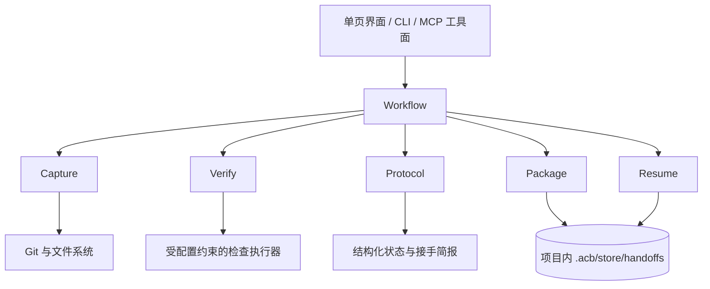

# 总体架构（v0.2 · 与源码一致）

ACB 是**本机**的 Agent 上下文交接工具。范围只有一件事：把当前项目的真实进度封存成不可变交接包，
并渲染成一份接手简报，让下一个 Agent 只读这一份文件就能接着干。
跨电脑（导出文件、推 GitHub 分支）不在范围内，代码里已无传输层。

## 1. 产品范围

- 同一台机器上换 Agent / 换订阅继续同一个任务（主路径）。
- 同一台机器上把某次封存的状态还原到另一个目录再查看（次路径；不提供就地覆盖当前工作区）。
- 围绕 Git 项目：捕获基线 + 暂存区 + 工作区（含新文件、删除、重命名），可选执行已配置检查并记录证据。
- 一个工作目录下可以有多个 Task，各自生成交接，父子关系保留。

## 2. 总体形态

本地模块化单体 + 版本化文件协议。核心逻辑跑在用户设备上，没有中心服务器，也没有可替换的传输 Adapter。



`server/core/` 下每个 Module 一个文件；Protocol 只定义数据含义与校验，不调用外部工具；
Workflow 负责编排。界面、CLI、Agent 工具三条入口共用同一批 Module，**同一事实只有一处算法**。

## 3. Module 与 Interface

| Module | 文件 | 提供的 Interface | 内部承担 |
| --- | --- | --- | --- |
| Workflow | `workflow.ts` | 创建交接 | 顺序、进度、阶段结果、封存后写项目侧接入 |
| Capture | `capture.ts` | 捕获稳定 Snapshot | 基线、索引、工作区、新文件、纳入范围、环境观测、捕获期间变化检查 |
| Infer | `infer.ts` | 从现场推断任务/进度/下一步 | 分支名与提交标题、diff 新增符号、TODO 原文、未同步测试、`.acb/NEXT.md` 便签；逐行认出 ACB 自己的脚印 |
| Verify | `verify.ts` | 在指定 Snapshot 上执行已配置检查 | 超时、日志尾部、输入指纹与环境记录 |
| Protocol | `protocol.ts` | 校验状态、渲染接手简报与恢复报告 | 版本兼容、事实/声明分离、确定性 Markdown 渲染 |
| Package | `package.ts` | 封存、清单、逐条目校验 | 恢复材料落盘、manifest 摘要 |
| Resume | `resume.ts` | 预览、恢复到指定目录 | 完整性、代码匹配、环境差异、验证时效、接手报告 |
| Bridge | `bridge.ts` | 项目侧接入：接入块 + 交接指针 | `AGENTS.md` 标记区维护（只动自己那一段）、`.acb/LATEST.md` 重写、`NO-BRIDGE` 停用约定、自封存命令解析 |
| Takeover | `takeover.ts` | Agent 直接接手：`at`/`projectId`/`handoffId` → 摘要 / 文件清单 / 简报原文 | 判据与 REST、Agent 工具、CLI 共用一份；返回里带两边 token 估算（不省就没意义） |
| Store | `store.ts` | 注册表与交接记录读写 | 原子写（临时文件→fsync→rename）、坏文件点名并降级 |
| Overview | `overview.ts` | 首页状态条与档案定位 | 任务分组、分叉判定、完整性实测 |
| 守卫 | `local-guard.ts`、`arg-guard.ts` | — | 只绑回环、Host/Origin 白名单、可选令牌；路径与 ID 形态白名单 |

`resume-flow.ts` 与 `registry.ts` 这类编排同理：**REST 路由、CLI 与 Agent 工具共用同一份实现**
（"定位封存包 → 执行 → 落报告"、"判定工作区 → 登记 → 装接入"），
避免"预览说写 12 个、实际写 11 个"这类同源分叉。

## 4. 三种内容的可信度

| 内容 | 来源 | 接手方如何使用 |
| --- | --- | --- |
| Observation | Git、文件系统、环境探测 | 带采集范围与时间的事实 |
| Verification Record | 检查执行器 | 仅当代码输入、环境与执行范围匹配时算证据 |
| Agent Claim | Agent 或用户 | 工作解释与建议；靠关联证据判断可信度 |

"修复了登录问题"是声明；"指定快照上执行登录测试，退出码 0"是验证记录；没跑就是未执行。
失败测试同样是有价值的交接内容，不妨碍封存。

## 5. 创建交接（本机）

1. 读取项目配置；任务名与人没写的部分由 Infer 从现场推断（给了就用人的，推断只在有证据时成立）。
2. Capture 捕获基线、索引与工作区，建立 Snapshot；捕获期间发生变化就重捕或报不一致。
3. 可选运行已配置检查（在独立物化目录里），未执行/超时/执行器异常各自记录。
4. Protocol 汇总 Project State，标明缺失或不可恢复的材料，并做不变量校验。
5. Package 写出恢复材料 + manifest + `HANDOFF.md`，落在 `<project>/.acb/store/handoffs/<id>/`。
6. Bridge 把入口写进项目本身：重写 `.acb/LATEST.md` 指针，并维护 `AGENTS.md` 里那段接入块
   （项目里有 `.acb/NO-BRIDGE` 时不碰 AGENTS.md）。这一步失败不作废已封存的包，
   但结果必须如实回给调用方 —— 界面与 CLI 都说得出这次写了什么、为什么没写。
7. 界面给出简报绝对路径与上面这一步的真实结果（"复制一段话给下一个 Agent"降级为备用入口）。

检查目录提供工作区隔离，**不等同操作系统沙箱**；检查若改动输入代码，该次结果失效。
封存之后不可原地修改：新证据产生新交接，父子关系保留。

## 6. 恢复到另一个目录

1. 按 `projectId`（留空取最新）在本机封存存储里定位交接；ID 形态先判死再拼路径。
2. 预览：逐条目实算 SHA-256、与目标目录比对撞车项、评估大小写/保留名/长路径，**一个字节都不写**。
3. 恢复：重建基线历史（bundle）→ 物化基线文件 → 分别落地暂存版与工作区版 → 重建空目录与链接形态。
4. 复算代码指纹，与快照比对；核对"清单条目数 / 通过数 / 写入数 / 基线应写与实际写"。
5. 生成 Resume Report（可继续 / 需要配置环境 / 需要重新验证 / 恢复被阻塞）并写 `ACB-HANDOFF.md`、`ACB-RESUME-REPORT.md`；
   真的写了代码才在目标目录装接入块与指针（被阻塞的那次一个字节都不写，包括不写 AGENTS.md）。

源端通过的测试在报告里标明为历史证据；接收端未跑就是未验证。
包内文字与路径一律当数据，不作为命令执行。

## 7. 生命周期与并发

捕获与恢复都经 `jobs.ts` 异步化并回报进度（大仓库的 bundle 会慢，没有进度就像卡死）。
捕获期间的外部编辑由一致性检查发现并拒绝，不做静默重试。
同一工作目录的并发写由"还原目标必须是另一个目录"这条边界挡住；不自动合并两个开发结果。

摘要校验能发现损坏与错配，**不能证明发布者身份** —— 本产品的信任边界就是"这台机器的这个用户"，
所以服务只绑回环，且 Host/Origin 按固定字面量判定。

## 8. 工程落点

```
shared/types.ts    协议类型（前后端共用）
server/core/*      上表的核心 Module
server/index.ts    Express API；server/main.ts 才 listen
server/agent/*     16 个 acb.* 工具（schema 校验 + risk/confirm 集中设闸）
src/*              单页界面
desktop/*          Electron 壳
tests/e2e.ts       端到端验收（ACB_HOME 隔离，不碰 ~/.acb）
```

被交接项目里只留 `.acb/store/`（可共享的交接材料）；注册表与恢复报告在 `~/.acb/`。
生成物（`dist*`、`release/`、`node_modules/`）全部 gitignore，删了可重建。
