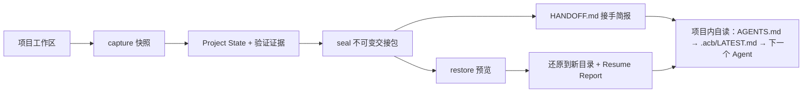

# Agent Context Bridge · 架构文档

版本 **v0.2（2026-10-09）**。系统已实现并在本机跑通：单页界面、CLI、MCP 工具面（16 个 `acb.*`）、
Electron 便携版、端到端验收 153 项。本目录说明**为什么这样设计**；怎么用见根目录 `使用说明.txt` 与 `README.md`。

## 范围的变化（v0.1 → v0.2）

v0.1 的验收目标写的是"跨电脑续接"，因此带了传输层：自包含 `.acb.tar.gz` 导出、GitHub 交接分支、
远端列表与读取确认、归档 SHA-256 双向核对。

实际使用场景是**同一台机器上换 Agent 订阅**：上一个 Agent 额度用尽，下一个接手，代价花在
"重读长记录 + 重新扫仓"。v0.2 据此把跨电脑整条链路撤掉：

| 撤掉 | 替代 |
| --- | --- |
| `transport.ts`（发布/取回/列分支）、`publish.ts`、tar 归档导出 | 交接包就落在 `<project>/.acb/store/handoffs/<id>/` |
| 三种恢复来源（文件 / 本机封存 / 远端分支） | 一种：本项目已封存的交接（留空取最新） |
| `githubRemote` 配置、远端白名单 `assertSafeGitRemote` | 无远端概念；守卫收敛为 `arg-guard.ts`（路径与 ID 形态） |
| 归档 SHA-256 跨机核对 | 逐条目 SHA-256 实测 + 代码指纹复算（同机仍然需要） |
| Agent 工具 17 个 | 15 个（撤下 `handoff_publish`、`remote_handoffs`），随后为"Agent 直接接手"加回 1 个 `handoff_takeover` = 16 |
| 交接内容靠人写三个框（任务/现状/下一步） | 新增 `server/core/infer.ts`：从分支名、提交标题、diff 新增符号、代码里的 TODO、未同步测试推断，人只改不对的地方 |
| （无此概念） | 新增便签约定 `<项目>/.acb/NEXT.md`：正在干活的 Agent 自己交代意图，封存时自动采纳并标为 Agent 声明 |
| 封存后靠人把一段话粘给下一个 Agent | 新增 `server/core/bridge.ts` 项目侧接入：`AGENTS.md` 里一段固定接入块（只写一次）+ `.acb/LATEST.md` 指针（每次封存重写，内含 Agent 自己能跑的封存命令）。交接的"送达"不再需要人在场 |
| Agent 只能靠读文件拿交接 | 新增 `server/core/takeover.ts`：HTTP `GET /api/handoff-brief`、工具 `acb.handoff_takeover`、CLI `acb takeover` 同一份判据，`at=<工作目录>` 一次问到该接什么。**判据是必须比丢简报省 token**，`npm run tokens` 实测：摘要 23%、文件清单 2%、精简 MCP 43%（大现场 19%），返回里 `cost` 自带两边数字 |
| `acb.handoff_create` 必须带 `taskName` | `taskName` 可留空：被换掉的那个 Agent 自己封存时不该被迫现编一句人类文案，留空即用推断结果 |
| 服务只绑回环 | 不变；守卫从 remote-policy 收敛为 arg-guard（路径与 ID 形态） |

包格式（协议 **0.1**）**没有变**：`project-state.json` / `manifest.json` / `payload/` 的字段与含义照旧，
只是不再需要表达"传输"。旧记录里残留的 `publications` 字段被忽略，不报错。

## 两个核心能力（未变）

1. **上下文交接**：从 Git、检查、环境信息与 Agent 声明生成 Project State，封存为不可变 Handoff Package，
   并渲染成一份自足的接手简报 `HANDOFF.md`（列出改动文件路径、可复跑的检查命令、需本机补齐的材料）。
2. **可核对的续接**：接收侧先校验再落地，产出恢复报告（四态判定 + 逐项对账），
   并在项目里留下接入块与指针 —— 交接的送达不依赖有人转述。

## 为什么要有"项目侧接入"这一层

只做"内容生成"的话，工具仍然站在提示词那一侧：产出一段话，等人把它送到另一个 Agent 手里。
送不到（人不在、忘了、换了客户端）交接就等于没发生。所以封存的最后一步是把入口写进**项目本身**：

- 谁打开这个项目都先读 `AGENTS.md`（Agent 客户端的通用约定）→ 那里指着 `.acb/LATEST.md`；
- 指针里除了"该读哪份简报"，还有一条**可直接跑的封存命令**，所以被换掉的那个也能自己收尾；
- 接入块是固定文案，因此只写一次；每次封存重写的是指针，避免项目里多出一处永远在变的 diff；
- 这一步失败不作废已经封好的包（包不可变），但必须如实报"没写上"，由界面/CLI 说清原因。

## 总体形态

本地模块化单体 + 版本化文件协议，服务只绑回环。

## 文档入口

| 需要了解的内容 | 文档 |
| --- | --- |
| 总体结构、模块职责、封存与恢复流程（与源码一致） | [总体架构](ARCHITECTURE.md) |
| Project State、Handoff Package 与证据规则 | [协议轮廓](PROTOCOL-OUTLINE.md) |
| 统一领域术语（观测 / 声明 / 验证记录 / 封存） | [术语表](CONTEXT.md) |
| Agent 的阅读入口与工作约束 | [Agent 接手说明](AGENTS.md) |
| 历史架构取舍（含已撤下的跨机传输决策） | [协议优先](adr/0001-protocol-first.md)、[交接检查点](adr/0002-handoff-checkpoints.md) |
| Agent 工具面与本机守卫 | [../agent/README.md](../agent/README.md) |
